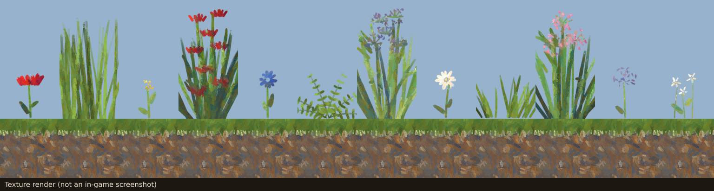
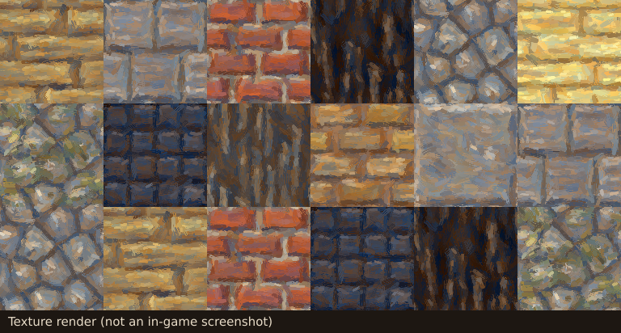
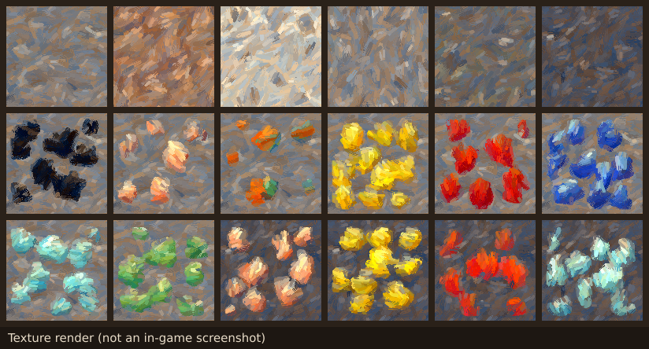
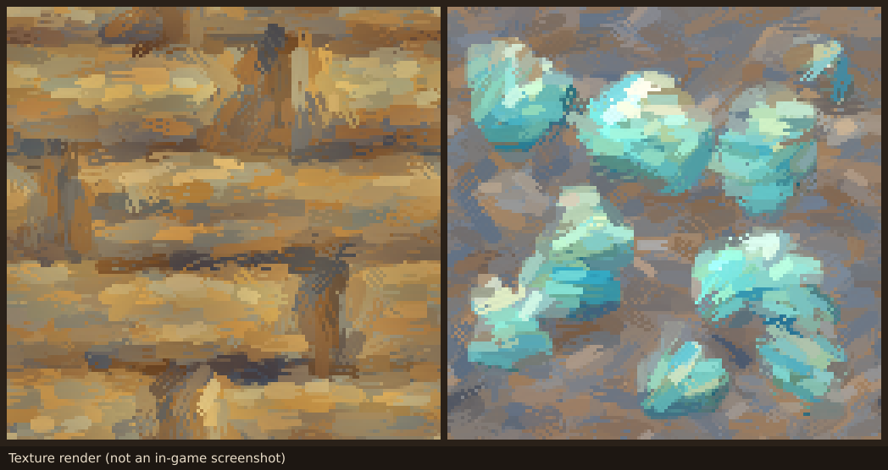

# Raphael Oil

Minecraft's blocks, plants, items and mobs repainted as small oil paintings: brush strokes instead of pixels.

**[Download the latest release](https://github.com/Nacryos/raphael-oil/releases/latest)** · Minecraft Java Edition 26.3

**NOT AN OFFICIAL MINECRAFT PRODUCT. NOT APPROVED BY OR ASSOCIATED WITH MOJANG OR MICROSOFT.**

*All images on this page are texture renders, not in-game screenshots.*

## What it is

Raphael Oil is a free resource pack for Minecraft Java Edition 26.3. It repaints the game's textures as oil paintings at
128 × 128 pixels per block face. That covers 1,430 block textures plus items, mobs, particles and the interface.

Every block is painted, then laid over in loose oil strokes, so a stone wall, a meadow or an ore vein reads as brushwork
rather than pixels. Blocks meet their neighbours without seams, ores sit in their stone's own paint, and two-block plants
stand on the ground as one plant.

| | |
|---|---|
|  |  |

## Features

- 1,430 block textures at 128 px, with random variants for stone, dirt, sand, gravel, leaves and ores
- 831 items, 743 entity textures, 300 particles and 555 GUI sprites, painted in the same oil style
- Seamless tiling: each block is painted on a torus, so it has no edge to show
- Ores, moss and grass sides are painted on their base block's paint
- Two-block plants painted as one plant
- Optional PBR maps (LabPBR) that give the paint impasto relief and sheen with shaders

## Which zip to pick

| file | for |
|---|---|
| `Raphael-Oil-0.5.0.zip` | Most players: the painted oil colour everywhere. Works in plain Minecraft, with Sodium, and with OptiFine or Iris without shaders. |
| `Raphael-Oil-0.5.0-PBR.zip` | Shader users: the same textures plus LabPBR normal and specular maps. The impasto relief and sheen appear **only** with a shader pack that reads LabPBR maps (for example Iris + BSL or Complementary). Without one, it looks the same as the default zip. |

## Install

1. Download a zip from the [releases page](https://github.com/Nacryos/raphael-oil/releases/latest).
2. In Minecraft: Options → Resource Packs → Open Pack Folder, and drop the zip in. Do not unzip it.
3. Move the pack from the left list to the right list, then Done.

Mojang's painting artworks (the pictures on placeable paintings) are not included, so the game's own paintings show.

## How it was made

Every texture was painted by Raphael, a brush-stroke painting program, using the vanilla texture only as a reference for
shape and colour. Raphael and the per-texture painting recipes were written with AI coding assistants (Claude) under the
author's direction. No image-generation model was used to make any texture or image in this pack.

## Licence

Free to download and use in your own game, on servers, in videos and in screenshots. Please share the official download
link (https://github.com/Nacryos/raphael-oil/releases) instead of re-uploading. Do not sell it or put it in paid products.
Full text: [LICENSE.txt](LICENSE.txt) (© 2026 Nacryos, all rights reserved). Minecraft and its original textures belong to
Mojang/Microsoft.

Publisher: [Nacryos](https://github.com/Nacryos). Changes: [CHANGELOG.md](CHANGELOG.md).

**NOT AN OFFICIAL MINECRAFT PRODUCT. NOT APPROVED BY OR ASSOCIATED WITH MOJANG OR MICROSOFT.**
